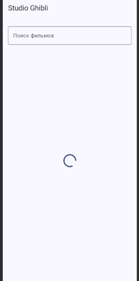
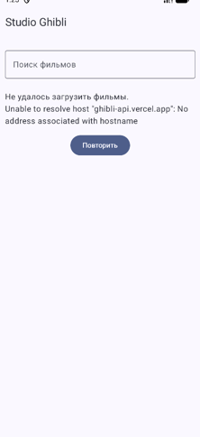
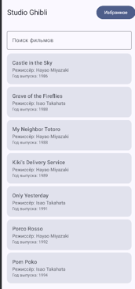
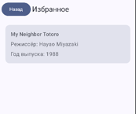
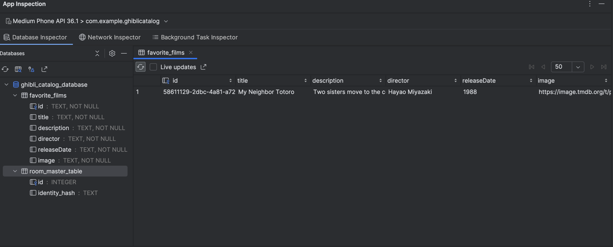

# GhibliCatalog

**Состина Арина Викторовна** 
**Группа Б9124-09.03.03пикд(2)**

## API
Используется **Studio Ghibli API** - API с информацией о фильмах студии Ghibli: названиями, описаниями, режиссёрами, датами выхода и рейтингами.

API: https://ghibliapi.vercel.app/

Не требует ключа.

## Как запустить проект
1. Открыть проект в Android Studio.
2. Дождаться завершения Gradle Sync.
3. Запустить эмулятор Android или подключить устройство.
4. Нажать **Run ▶**.

## Room
В Room хранится список избранных фильмов.

**Таблица:** `FavoriteFilm` (избранные фильмы).

**Сценарии:**
- Добавление фильма в избранное.
- Получение сохранённых фильмов из базы данных.
- Удаление фильма из избранного.
- Проверка отсутствия дубликатов при повторном добавлении фильма.

## Тесты

**Юнит-тесты: 8**

Покрытые сценарии:
- Начальное состояние экрана загрузки.
- Успешная загрузка списка фильмов.
- Пустой список фильмов.
- Ошибка загрузки.
- Повторная загрузка после ошибки.
- Получение фильма по ID через репозиторий.
- Последовательности состояний `Loading → Success` и `Loading → Error → Loading → Success`.
- Получение текущего состояния `StateFlow` новым подписчиком.

**Интеграционные тесты: 5**

Покрытые сценарии:
- Сохранение избранного фильма в Room и чтение из базы.
- Удаление фильма из Room.
- Добавление и чтение избранного через репозиторий.
- Проверка отсутствия дубликатов избранного.
- Переход с экрана списка на экран деталей с правильным ID фильма.

## Скриншоты

Скриншоты приложения и состояния Room будут добавлены ниже.

### 1. Loading

### 2. Error

### 3. List

### 4. Detail

### 5. Favourites

### 6. Room

Ветка для пр
